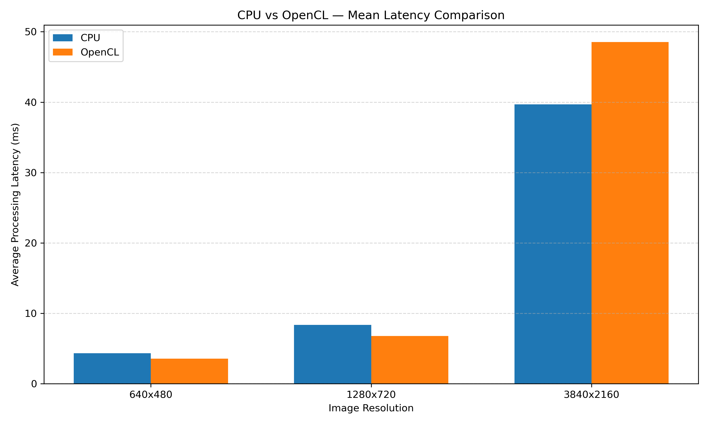

# CPU vs OpenCL Image Processing Benchmark

A ROS 2 Jazzy project comparing CPU-based and GPU-accelerated image processing using OpenCV and OpenCL.

The project evaluates Gaussian Blur processing latency at different image resolutions using an Intel CPU and NVIDIA GeForce RTX 2050 GPU.

## Project Overview

This project investigates how image resolution affects CPU and GPU processing performance.

It uses:

- ROS 2 Jazzy for image publishing and subscription.
- OpenCV for image processing.
- OpenCL for GPU acceleration.
- Gaussian Blur (31×31 kernel) as the benchmark operation.
- Python and Matplotlib for result visualization.

## Hardware and Software

| Component            | Specification                  |
| -------------------- | ------------------------------ |
| Operating System     | Ubuntu 24.04                   |
| ROS 2                | Jazzy                          |
| CPU                  | Intel Core i5-11320H           |
| GPU                  | NVIDIA GeForce RTX 2050 (4 GB) |
| OpenCV               | 4.6.0                          |
| Acceleration         | OpenCL                         |
| Image Format         | BGR                            |
| Processing Operation | 31×31 Gaussian Blur            |

## Benchmark Results

Three runs were performed for each resolution and processing mode.

| Resolution | CPU Mean (ms) | OpenCL Mean (ms) | Observation                |
| ---------- | ------------: | ---------------: | -------------------------- |
| 640×480    |         4.326 |            3.558 | OpenCL 17.7% lower latency |
| 1280×720   |         8.373 |            6.777 | OpenCL 19.1% lower latency |
| 3840×2160  |        39.666 |           48.525 | CPU 22.3% lower latency    |

### Mean Latency Comparison



### Key Findings

- OpenCL achieved lower mean latency at 640×480 and 1280×720.
- CPU processing performed better at 3840×2160.
- GPU data-transfer and synchronization overhead can affect performance.
- GPU acceleration does not guarantee better performance at every resolution.

## Project Structure

```text
cpu_gpu_benchmark/
├── CMakeLists.txt
├── LICENSE
├── package.xml
├── README.md
├── docs/
│   └── CPU_vs_OpenCL_Benchmark_Report.pdf
├── include/
│   └── cpu_gpu_benchmark/
├── results/
│   ├── benchmark_results.csv
│   └── graphs/
│       └── mean_latency_comparison.png
├── scripts/
│   └── plot_results.py
└── src/
    ├── benchmark_node.cpp
    └── image_publisher.py
```

## Installation

Create and build the ROS 2 workspace:

```bash
mkdir -p ~/accel_ros2_ws/src
cd ~/accel_ros2_ws/src
```

Clone this repository into the `src` directory:

```bash
git clone https://github.com/harshadapawar129-hub/cpu-gpu-benchmark.git
```

Install the required ROS 2 dependencies and OpenCV development libraries if they are not already installed.

Build the package:

```bash
cd ~/accel_ros2_ws
source /opt/ros/jazzy/setup.bash
colcon build --packages-select cpu_gpu_benchmark
source install/setup.bash
```

## Running the Benchmark

### Terminal 1: Start the image publisher

```bash
source /opt/ros/jazzy/setup.bash
source ~/accel_ros2_ws/install/setup.bash
ros2 run cpu_gpu_benchmark image_publisher.py
```

### Terminal 2: CPU benchmark

```bash
source /opt/ros/jazzy/setup.bash
source ~/accel_ros2_ws/install/setup.bash
ros2 run cpu_gpu_benchmark benchmark_node --ros-args -p mode:=cpu
```

### Terminal 3: OpenCL benchmark

```bash
source /opt/ros/jazzy/setup.bash
source ~/accel_ros2_ws/install/setup.bash
ros2 run cpu_gpu_benchmark benchmark_node --ros-args -p mode:=opencl
```

Run CPU and OpenCL tests separately. Stop the benchmark node between runs.

## Regenerating the Graph

From the package directory:

```bash
python3 scripts/plot_results.py
```

The graph will be saved to:

```text
results/graphs/mean_latency_comparison.png
```

## Methodology and Limitations

- Synthetic BGR images are used as input.
- The benchmark operation is OpenCV Gaussian Blur with a 31×31 kernel.
- CPU timing measures the GaussianBlur call.
- OpenCL timing includes image upload, processing, download, and synchronization.
- The timing boundaries are therefore not identical.
- At 640×480 and 1280×720, each run used 100 measured frames.
- At 4K, CPU runs used 100 measured frames, while OpenCL runs used 30.
- Reported FPS is calculated from mean latency and is not actual ROS stream throughput.
- OpenCL device selection was confirmed, but sustained GPU utilization was not established.

## Detailed Report

See the PDF report in [`docs/`](docs/CPU_vs_OpenCL_Benchmark_Report.pdf).

## Author

Harshada Pawar

## License

This project is licensed under the Apache License 2.0. See [LICENSE](LICENSE) for details.
